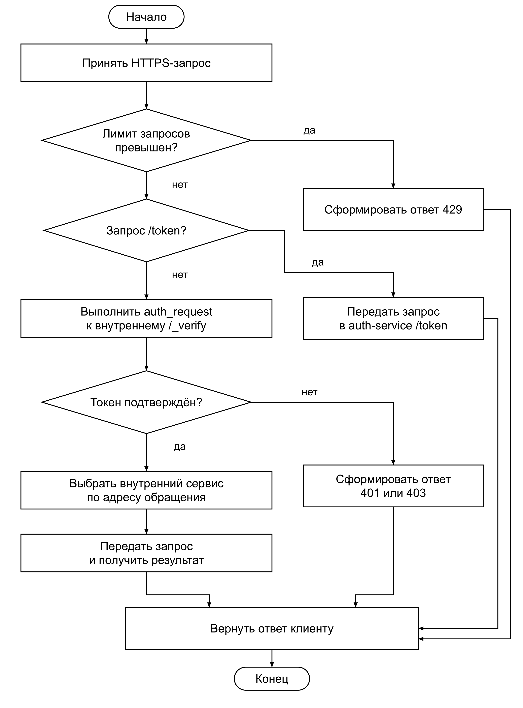
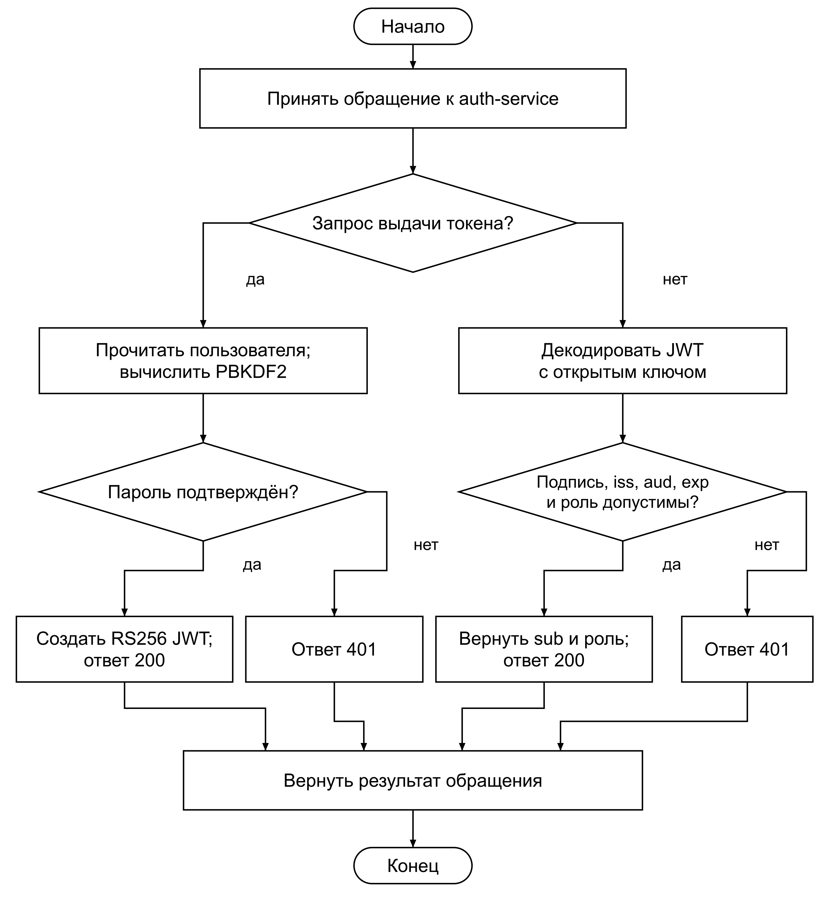
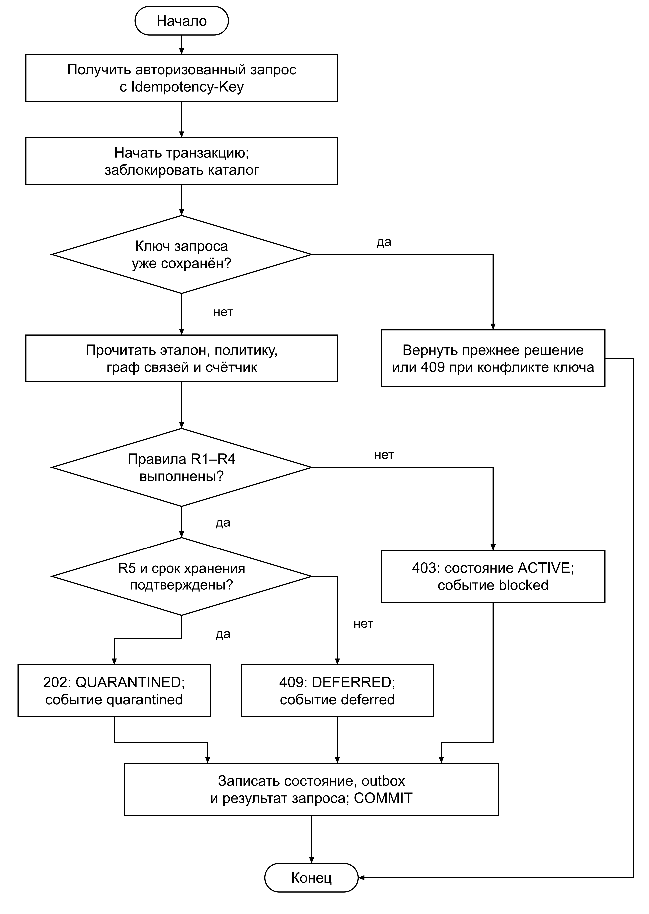
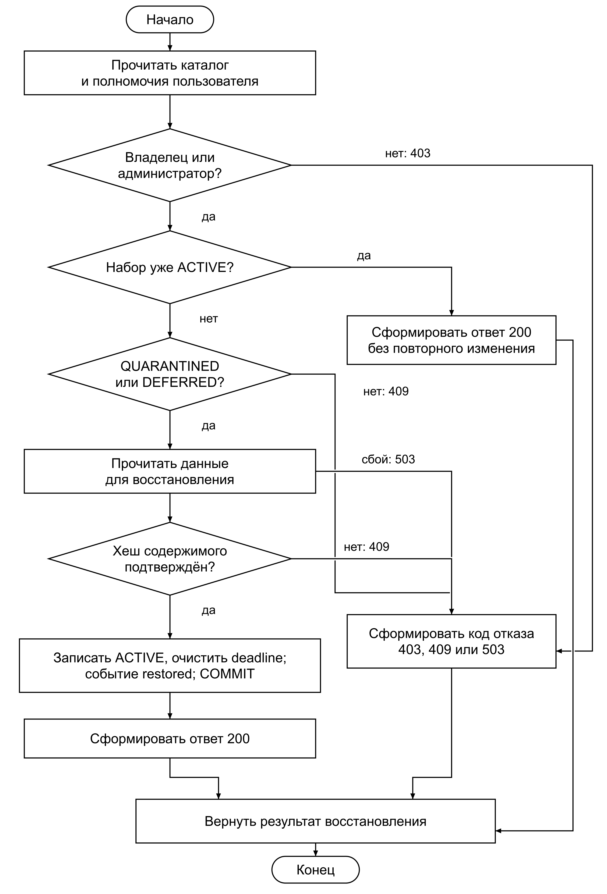
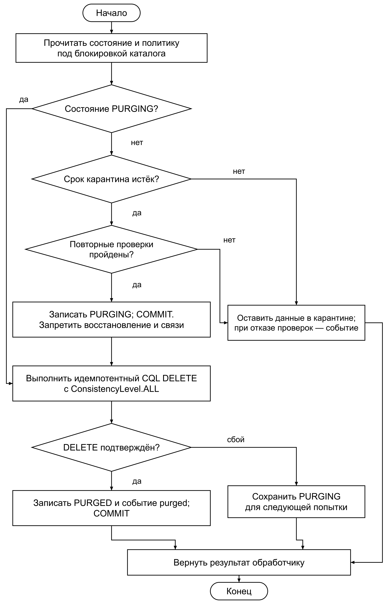
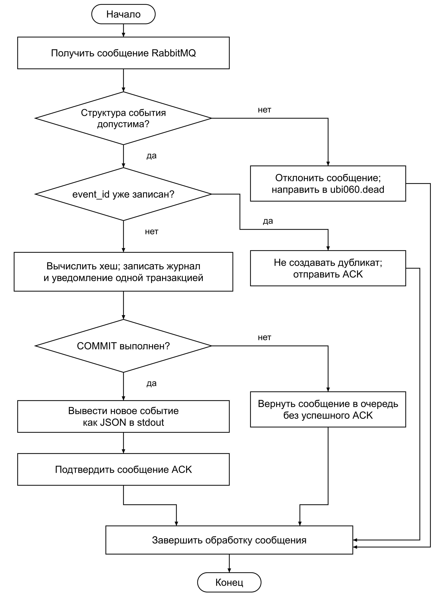
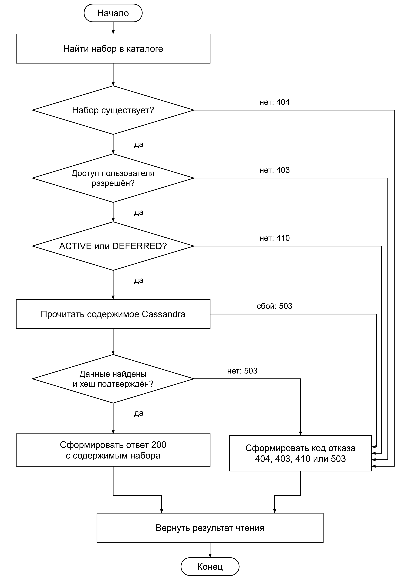

# 3 Разработка микросервисов

Разработанный во втором разделе паттерн реализован как система взаимодействующих микросервисов. Пользователь обращается к единой точке входа, проходит аутентификацию и получает доступ к операциям с наборами данных. Запрос на удаление проверяется сервисом безопасности, разрешённая операция переводит данные в карантин, а её результат поступает в журнал. Такая последовательность связывает программные компоненты с механизмом противодействия угрозе УБИ.060: изменение политики или ошибочное назначение удаления не должно приводить к неконтролируемой потере информации.

В настоящем разделе рассматриваются функции, обеспечивающие эту последовательность, и средства их развёртывания. Для каждого микросервиса сначала приведён код основных функций, затем блок-схема и связное описание соответствующего алгоритма. Полные исходные файлы, зависимости и сценарии запуска размещены в репозитории проекта [36]. Реализация функций отделена от настройки контейнеров: сначала рассматривается обработка запроса внутри сервиса, после чего объясняется, как отдельные процессы объединяются в работающий стенд.

## 3.1 Функции микросервисов

В состав паттерна входят nginx-gateway, auth-service, delete-guard, quarantine-service и audit-service. Защищаемое приложение представлено отдельным сервисом data-api; его функции также рассматриваются, поскольку именно приложение должно скрывать карантинные данные и сохранять возможность чтения при отложенном удалении. Python-сервисы используют FastAPI и Uvicorn, а их доменные операции вынесены в app/domain.py. Такое разделение позволяет применять одну и ту же функцию из HTTP-обработчика и фонового процесса и проверять её независимо от способа доставки запроса [20, 21].

Каждому сервису соответствует собственный процесс и сетевой порт. Они используют общие модели данных, но выполняют разные операции: шлюз направляет обращение, служба аутентификации подтверждает личность, guard принимает решение, карантин управляет сроком сохранения, а аудит фиксирует результат. Общая последовательность обработки определяет порядок дальнейшего изложения: от входящего HTTPS-запроса до окончательного удаления и получения уведомления. Основные внешние операции перечислены в таблице 11.

Таблица 11 – Основные операции микросервисов

| Компонент | Операция | Результат |

| --- | --- | --- |

| nginx-gateway | HTTPS и auth_request | Проверка доступа и передача запроса |

| auth-service | POST /token; GET /verify | JWT либо подтверждённые полномочия |

| delete-guard | DELETE /deletions/{id} | 202, 403 или 409 с причиной решения |

| quarantine-service | POST /quarantine/{id}/restore; фоновое удаление | Восстановление или завершение карантина |

| audit-service | Получение события; GET /notifications | Запись журнала и уведомление адресату |

| data-api | GET /datasets/{id}; POST /datasets | Чтение доступных данных и контролируемая загрузка |

### 3.1.1 Шлюз nginx-gateway

Обработка обращения начинается на шлюзе nginx-gateway. Он принимает HTTPS-соединение, ограничивает частоту запросов и определяет, какому сервису передать операцию. Благодаря этому пользователь работает с одним адресом, а внутренние процессы сохраняют отдельные API. Для получения токена предусмотрен маршрут /token, доступный до аутентификации. Остальные прикладные маршруты требуют положительного ответа службы проверки JWT.

Конфигурация в листинге 1 задаёт TLS, внутренний маршрут /_verify и правила проксирования. Директива internal закрывает служебную проверку от прямого обращения клиента. При выполнении auth_request NGINX передаёт заголовок Authorization в auth-service и продолжает обработку только при разрешающем ответе [31]. Перед проксированием произвольные X-User и X-Role очищаются, поэтому клиент не может назначить себе роль таким заголовком. Лимит limit_req установлен на уровне шлюза, тогда как общий счётчик операций удаления будет проверяться в PostgreSQL сервисом delete-guard.

**Листинг 1 – Конфигурация приёма и маршрутизации запросов**

Файл: `deploy/nginx.conf`

```nginx

worker_processes auto;
pid /tmp/nginx.pid;
error_log /dev/stderr warn;
events { worker_connections 1024; }
http {
    access_log /dev/stdout;
    client_max_body_size 1m;
    client_body_temp_path /tmp/client_temp;
    proxy_temp_path /tmp/proxy_temp;
    limit_req_zone $binary_remote_addr zone=api:10m rate=10r/s;
    limit_req_status 429;
    server {
        listen 8443 ssl;
        ssl_certificate /etc/tls/tls.crt;
        ssl_certificate_key /etc/tls/tls.key;
        ssl_protocols TLSv1.2 TLSv1.3;
        location = /healthz { access_log off; return 200 'alive'; }
        location = /token {
            limit_req zone=api burst=10 nodelay;
            proxy_pass http://auth-service.pattern.svc.cluster.local:8001;
        }
        location = /_verify {
            internal;
            proxy_pass http://auth-service.pattern.svc.cluster.local:8001/verify;
            proxy_pass_request_body off;
            proxy_set_header Content-Length "";
            proxy_set_header Authorization $http_authorization;
        }
        location / {
            limit_req zone=api burst=20 nodelay;
            auth_request /_verify;
            proxy_set_header Authorization $http_authorization;
            proxy_set_header X-User "";
            proxy_set_header X-Role "";
            proxy_pass http://data-api.data.svc.cluster.local:8000;
        }
        location ~ ^/(deletions|policies|dependencies|catalog)(/|$) {
            limit_req zone=api burst=20 nodelay;
            auth_request /_verify;
            proxy_set_header Authorization $http_authorization;
            proxy_set_header X-User "";
            proxy_set_header X-Role "";
            proxy_pass http://delete-guard.pattern.svc.cluster.local:8002;
        }
        location /quarantine {
            limit_req zone=api burst=20 nodelay;
            auth_request /_verify;
            proxy_set_header Authorization $http_authorization;
            proxy_pass http://quarantine-service.pattern.svc.cluster.local:8003;
        }
        location ~ ^/(audit|notifications)(/|$) {
            limit_req zone=api burst=20 nodelay;
            auth_request /_verify;
            proxy_set_header Authorization $http_authorization;
            proxy_pass http://audit-service.pattern.svc.cluster.local:8004;
        }
    }
}

```

Последовательность выбора маршрута и завершения обработки показана на рисунке 14. На схеме отделён запрос получения токена от обращений, для которых необходима проверка доступа. Ветки ограничения частоты и отказа в аутентификации возвращаются к общему завершению обработки запроса.



Алгоритм работы nginx-gateway начинается с установления HTTPS-соединения и проверки ограничения частоты. При превышении установленного значения шлюз формирует ответ 429 и завершает обработку. Если ограничение не превышено, определяется адрес обращения. Запрос /token направляется в auth-service для проверки логина и пароля. Для защищённого маршрута выполняется внутренний подзапрос /_verify, содержащий исходный Bearer JWT. Отказ службы аутентификации приводит к ответу 401 или 403 без передачи прикладной операции следующему сервису.

После успешной проверки шлюз выбирает получателя по адресу запроса. Операции чтения и загрузки передаются в data-api, удаление и изменение эталонов — в delete-guard, восстановление — в quarantine-service, а получение журнала и уведомлений — в audit-service. Полученный от внутреннего сервиса ответ возвращается пользователю. Следовательно, шлюз обеспечивает единую последовательность входных проверок, а решение о допустимости конкретной операции остаётся за соответствующим микросервисом. Для выполнения этой последовательности требуется служба аутентификации, реализация которой рассматривается далее.

### 3.1.2 Сервис аутентификации auth-service

Auth-service устанавливает личность пользователя и выдаёт подписанный токен с его ролью. При входе он принимает логин и пароль, находит учётную запись и сравнивает пароль с сохранённым результатом PBKDF2-HMAC-SHA256. Для каждой записи используется случайная соль и 600 000 итераций. Сами пароли в исходные файлы и контейнерный образ не включаются: при подготовке стенда создаются отдельные случайные значения. Основная функция выдачи токена приведена в листинге 2.

**Листинг 2 – Проверка учётной записи и выдача токена**

Файл: `app/api.py`

```python

def token(data: Login):
    user = (cfg.users or {}).get(data.username)
    # Unknown users still pay the PBKDF2 cost.
    encoded = user["hash"] if user else "pbkdf2$600000$"+"00"*16+"$"+"00"*32
    if not password_matches(data.password, encoded) or user is None:
        raise Problem(401, "Неверный логин или пароль")
    return {"access_token": issue_token(data.username, user["role"], cfg.jwt_private), "token_type": "bearer"}

```

После подтверждения учётной записи вызывается issue_token. Она формирует JWT со сроком действия 900 секунд, идентификатором пользователя, ролью, издателем, аудиторией и уникальным jti. Подпись RS256 создаётся отдельным закрытым ключом, доступным только auth-service. Функция verify_token использует открытый ключ и явно задаёт допустимый алгоритм, проверяет exp, iss, aud и обязательные поля. Эти функции приведены в листинге 3. FastAPI подключает проверку Bearer-токена как зависимость обработчика, что позволяет выполнять её до вызова прикладной операции [30].

**Листинг 3 – Формирование JWT и проверка его полномочий**

Файл: `app/security.py`

```python

def issue_token(subject: str, role: str, private: bytes, lifetime: int = 900) -> str:
    now = int(time.time())
    return jwt.encode({"sub": subject, "role": role, "iat": now, "exp": now + lifetime,
                       "iss": "ubi060-auth", "aud": "ubi060", "jti": str(uuid.uuid4())},
                      private, algorithm="RS256")

def verify_token(token: str, public: bytes) -> dict:
    claims = jwt.decode(token, public, algorithms=["RS256"], audience="ubi060",
                        issuer="ubi060-auth", options={"require": ["sub", "role", "exp", "iat", "jti"]})
    if claims["role"] not in {"analyst", "owner", "admin", "scheduler"}:
        raise jwt.InvalidTokenError("Unknown role")
    return claims

```

Обращения за токеном и за проверкой ранее выданного токена образуют два входных пути одного сервиса. Их общая блок-схема представлена на рисунке 15. Оба пути завершаются возвратом результата вызывающему компоненту.



Алгоритм работы auth-service сначала определяет тип обращения. При запросе на вход считывается учётная запись и выполняется вычисление PBKDF2 по переданному паролю. Для отсутствующей записи выполняется сопоставимая операция хеширования, после чего возвращается отказ. Если пароль подтверждён, из записи берётся назначенная роль, формируется набор полей JWT и создаётся подпись RS256. Пользователь получает токен и может включать его в последующие запросы к шлюзу.

При проверке готового токена выполняются декодирование и проверка подписи, издателя, аудитории, времени окончания и допустимой роли. Успешная проверка возвращает идентификатор и роль, а ошибка приводит к ответу 401. Внутренние сервисы дополнительно выполняют такую же проверку JWT перед собственными операциями. Поэтому дальнейшее решение об удалении опирается на подтверждённые полномочия и сведения о владельце из каталога, а не на поля, произвольно переданные клиентом. Эту информацию использует следующий компонент — delete-guard.

### 3.1.3 Сервис безопасности delete-guard

Delete-guard реализует основную функцию паттерна: принимает запрос на удаление и определяет, разрешено ли переводить конкретный набор в карантин. Проверка опирается на каталог PostgreSQL, где находятся владелец, состояние набора, действующая политика, подписанный эталон, граф зависимостей и результаты предыдущих обращений. Содержимое набора хранится в Cassandra, а в каталоге сохраняется его ожидаемый SHA-256. Это позволяет рассматривать состояние операции и запись о принятом решении в одной SQL-транзакции.

Эталон политики привязан к dataset_id и версии. Он определяет срок хранения, допустимый минимум, порог обращений, длительность окна счётчика и срок карантина. Перед подписанием JSON приводится к каноническому представлению, после чего вычисляется SHA-256 и создаётся RSA-PSS-подпись дайджеста. При проверке используются те же параметры. Код создания и проверки подписи приведён в листинге 4. Закрытый ключ эталона используется при административном утверждении политики; guard получает только открытый ключ. Идея подписанного эталона развивает подход к контролю целостности политик, рассмотренный в [6].

**Листинг 4 – Подпись и проверка эталона политики хранения**

Файл: `app/security.py`

```python

def sign_policy(policy: dict, private: bytes) -> str:
    key = serialization.load_pem_private_key(private, password=None)
    signature = key.sign(bytes.fromhex(digest(policy)),
                         padding.PSS(mgf=padding.MGF1(hashes.SHA256()), salt_length=32),
                         utils.Prehashed(hashes.SHA256()))
    return base64.b64encode(signature).decode("ascii")

def valid_policy(policy: dict, signature: str, public: bytes) -> bool:
    try:
        key = serialization.load_pem_public_key(public)
        key.verify(base64.b64decode(signature, validate=True), bytes.fromhex(digest(policy)),
                   padding.PSS(mgf=padding.MGF1(hashes.SHA256()), salt_length=32),
                   utils.Prehashed(hashes.SHA256()))
        return True
    except (InvalidSignature, ValueError, TypeError):
        return False

```

Проверки R1–R5 выполняются функцией _rules из листинга 5. Сначала подтверждается подпись эталона, затем сравниваются хеши действующей политики и эталона, проверяется минимальный срок и общий счётчик обращений пользователя. Далее анализируются входящие связи набора и читается его содержимое с ConsistencyLevel.ALL. Для успешного выполнения запроса должны ответить все реплики, заданные текущим replication factor [33]. Хеш прочитанного содержимого сопоставляется с каталогом, после чего дополнительно проверяется фактическое истечение срока хранения.

**Листинг 5 – Проверка правил R1–R5 и фактического срока хранения**

Файл: `app/domain.py`

```python

def _rules(self, c, row, actor, count=True, age=True):
    p = row["policy"]
    if not valid_policy(row["baseline"], row["signature"], self.public_key):
        return 403, "R1"
    if digest(p) != digest(row["baseline"]):
        return 403, "R2"
    if p["retention_seconds"] < p["minimum_seconds"]:
        return 403, "R3"
    if count:
        attempts = c.execute(select(func.count()).select_from(requests).where(
            requests.c.actor == actor["sub"], requests.c.created_at > self.clock()-p["window_seconds"])).scalar_one()
        if attempts >= p["delete_limit"]:
            return 403, "R4"
    if c.execute(select(dependencies.c.source).where(dependencies.c.target == row["id"])).first():
        return 409, "R5_dependencies"
    try:
        body = self.storage.get(row["id"])
    except StorageUnavailable:
        return 409, "R5_unavailable"
    if body is None or digest(body) != row["content_hash"]:
        return 409, "R5_content"
    if age and self.clock() < row["created_at"]+p["retention_seconds"]:
        return 409, "retention_not_expired"
    return 202, None

```

Функция request_delete объединяет эти проверки с защитой от повторного выполнения. Ключ Idempotency-Key связывается с пользователем и отпечатком запроса. Идентичное повторное обращение получает уже сохранённый результат, а использование того же ключа для другого набора отклоняется. Перед изменением каталога захватывается строка transaction_mutex. Она упорядочивает действия двух реплик guard, обновление графа связей и операции карантина. Полный код основной функции приведён в листинге 6.

**Листинг 6 – Транзакционная обработка запроса на удаление**

Файл: `app/domain.py`

```python

def request_delete(self, id, key, actor):
    if actor["role"] not in {"owner", "admin", "scheduler"}:
        raise Problem(403, "Удаление запрещено для роли")
    if not key or len(key) > 100:
        raise Problem(422, "Нужен Idempotency-Key длиной 1–100")
    scope = actor["sub"]+":"+key
    fingerprint = digest({"dataset_id": id, "actor": actor["sub"]})
    with self.db.transaction() as c:
        row = self._row(c, id)
        self.authorize(row, actor)
        old = c.execute(select(requests).where(requests.c.id == scope)).mappings().first()
        if old:
            if old["fingerprint"] != fingerprint:
                raise Problem(409, "Ключ уже использован для другого запроса")
            return old["code"], old["response"]
        if row["state"] == "QUARANTINED":
            code, rule = 202, None
        elif row["state"] == "PURGED":
            raise Problem(410, "Набор уже удалён")
        elif row["state"] == "PURGING":
            raise Problem(409, "Окончательное удаление уже началось")
        else:
            code, rule = self._rules(c, row, actor)
            state = "QUARANTINED" if code == 202 else ("ACTIVE" if code == 403 else "DEFERRED")
            deadline = self.clock()+row["policy"]["quarantine_seconds"] if code == 202 else None
            c.execute(update(datasets).where(datasets.c.id == id).values(state=state, deadline=deadline))
            self.event(c, row, actor, {202: "quarantined", 403: "blocked", 409: "deferred"}[code], rule)
        response = {"dataset_id": id, "decision": "allow" if code == 202 else "deny", "rule": rule,
                    "status": code}
        c.execute(insert(requests).values(id=scope, actor=actor["sub"], dataset_id=id,
            fingerprint=fingerprint, created_at=self.clock(), code=code, response=response))
        return code, response

```

Блок-схема на рисунке 16 показывает основной путь авторизованного обращения к набору в ACTIVE или DEFERRED: проверку повтора, выполнение правил и фиксацию решения. При ответе 409 состояние DEFERRED сохраняет отложенную операцию, но данные остаются читаемыми. В QUARANTINED они переходят только после разрешающего решения 202.



Алгоритм работы delete-guard начинается с проверки роли и принадлежности набора. После начала транзакции извлекаются состояние каталога и ранее сохранённый результат для переданного ключа. Если совпадающее обращение уже обработано, возвращаются прежние код и решение. Для уже карантинного набора возвращается 202, для PURGING — 409, а для PURGED — 410. Для нового запроса к ACTIVE или DEFERRED последовательно выполняются R1–R5. Нарушение R1–R4 приводит к состоянию ACTIVE и ответу 403. Входящие ссылки, неподтверждённое содержимое, недоступная реплика или ещё не истёкший срок хранения приводят к DEFERRED и ответу 409. Только прохождение всех условий разрешает карантин.

Затем в одной транзакции записываются новое состояние, срок карантина, результат запроса и событие outbox. Ответ отправляется после COMMIT. При недоступной БД разрешение 202 не формируется, поскольку надёжно зафиксировать решение невозможно. Порог обращений хранится в PostgreSQL и одинаков для всех реплик guard; локальный лимит шлюза не заменяет эту проверку. Сохранённое событие позднее передаётся в RabbitMQ, а за дальнейшую судьбу самого набора отвечает quarantine-service. Так завершается принятие решения и начинается отдельный этап управляемого хранения перед удалением.

### 3.1.4 Сервис карантина quarantine-service

Quarantine-service обслуживает два разных действия с уже принятым решением: восстановление по запросу пользователя и окончательное удаление после истечения срока. Для обоих действий используется состояние из PostgreSQL. Оно определяет, можно ли вернуть набор в работу или необратимая стадия уже началась. Разделение операций особенно важно при сбое: отсутствие HTTP-ответа не должно приводить к одновременному восстановлению и удалению одних и тех же данных [15].

Восстановление выполняет функция restore из листинга 7. Она проверяет полномочия владельца либо администратора, состояние каталога и хеш сохранённого содержимого. Для уже активного набора возвращается текущее состояние, что делает повторное обращение безопасным. Для QUARANTINED или DEFERRED функция переводит набор в ACTIVE, очищает срок и создаёт событие restored. Состояния PURGING и PURGED исключают восстановление.

**Листинг 7 – Восстановление набора из карантина**

Файл: `app/domain.py`

```python

def restore(self, id, actor):
    with self.db.transaction() as c:
        row = self._row(c, id)
        if actor["role"] not in {"owner", "admin"}:
            raise Problem(403, "Восстановление разрешено владельцу и администратору")
        self.authorize(row, actor)
        if row["state"] == "ACTIVE":
            return {"id": id, "state": "ACTIVE"}
        if row["state"] not in {"QUARANTINED", "DEFERRED"}:
            raise Problem(409, "Восстановление уже невозможно")
        body = self.storage.get(id)
        if body is None or digest(body) != row["content_hash"]:
            raise Problem(409, "Данные для восстановления не подтверждены")
        c.execute(update(datasets).where(datasets.c.id == id).values(state="ACTIVE", deadline=None))
        self.event(c, row, actor, "restored")
    return {"id": id, "state": "ACTIVE"}

```

Путь восстановления показан на рисунке 17. Общая точка завершения объединяет успешное восстановление, повторный запрос и отказ по условиям доступа или состоянию данных.



Алгоритм восстановления начинается с проверки вызывающего пользователя и чтения каталога под общей блокировкой. Если набор уже ACTIVE, возвращается ответ 200 без повторного изменения состояния. Для остальных наборов проверяется возможность восстановления: операция допускается только до перехода в PURGING. Затем считывается содержимое и сопоставляется его хеш. При нарушении полномочий возвращается 403, а при недопустимом состоянии или неподтверждённых данных — 409. При недоступности хранилища обработчик API возвращает 503. Сами данные при отказе не переводятся в активное состояние.

При положительном результате проверок в каталоге устанавливается ACTIVE и очищается deadline. В той же транзакции создаётся событие restored, а после COMMIT владелец получает подтверждение. Последующее чтение data-api вновь разрешает выдачу набора. Таким образом, восстановление изменяет доступность данных через авторитетное состояние каталога и оставляет проверяемую запись о выполненном действии.

Окончательное удаление выполняется фоновым обработчиком, который выбирает истёкший карантин и незавершённые записи PURGING. Функция purge_one приведена в листинге 8. Перед первым DELETE она повторяет проверки политики, зависимостей и содержимого, поскольку условия могли измениться после постановки в карантин. Новые связи и изменение политики карантинного набора через API запрещены, а повторная проверка служит дополнительным условием перехода к необратимой стадии.

**Листинг 8 – Окончательное удаление с восстановлением обработки после сбоя**

Файл: `app/domain.py`

```python

def purge_one(self, id):
    # Phase 1 is durable BEFORE the nontransactional Cassandra DELETE.
    # PURGING is retried after crashes and can never be restored or linked.
    system = {"sub": "quarantine-worker", "role": "scheduler"}
    with self.db.transaction() as c:
        row = self._row(c, id)
        if row["state"] == "QUARANTINED":
            if row["deadline"] > self.clock():
                return False
            code, rule = self._rules(c, row, system, count=False)
            if code != 202:
                self.event(c, row, system, "purge_deferred", rule)
                return False
            c.execute(update(datasets).where(datasets.c.id == id).values(state="PURGING"))
        elif row["state"] != "PURGING":
            return False
    self.storage.delete(id)  # Idempotent tombstone; a crash here leaves PURGING, never ACTIVE.
    with self.db.transaction() as c:
        row = self._row(c, id)
        if row["state"] == "PURGING":
            c.execute(update(datasets).where(datasets.c.id == id).values(state="PURGED"))
            c.execute(delete(dependencies).where(dependencies.c.source == id))
            self.event(c, row, system, "purged")
    return True

```

Выполнение CQL DELETE относится к другой СУБД и не может войти в SQL-транзакцию каталога. Поэтому алгоритм разделён на подготовку, обращение к Cassandra и подтверждение результата. Соответствующая блок-схема показана на рисунке 18.



Алгоритм окончательного удаления сначала читает состояние набора. Если оно равно PURGING, обработчик возобновляет ранее начатый DELETE. Если набор находится в QUARANTINED, проверяются срок и правила безопасности. При неистёкшем сроке набор сохраняется до следующего просмотра; при отказе повторных проверок дополнительно фиксируется причина отложения. После успешной проверки в отдельной транзакции устанавливается PURGING. С этого момента восстановление и создание новых зависимостей для набора запрещены.

Далее выполняется идемпотентный CQL DELETE с ConsistencyLevel.ALL. Подтверждённый результат приводит к новой SQL-транзакции, которая записывает PURGED и событие purged. При сбое сохраняется PURGING, поэтому следующий запуск повторяет удаление, а не возвращает данные в ACTIVE. В Cassandra команда создаёт tombstone, тогда как освобождение диска происходит позднее при compaction. Для прототипа завершение PURGED означает окончание управляемой операции и прекращение восстановления через API. Сведения об этом результате, как и о восстановлении, поступают в audit-service.

### 3.1.5 Сервис аудита audit-service

Audit-service завершает цепочку обработки: получает события, сохраняет журнал и формирует уведомление адресату. Между изменением состояния и отправкой сообщения используется transactional outbox. Guard записывает событие одновременно с решением в PostgreSQL, затем его фоновый издатель отправляет persistent message в durable-очередь RabbitMQ и ожидает publisher confirm. Такое согласование сохраняет событие при временной недоступности брокера. Подтверждение издателя и ACK потребителя применяются на разных этапах доставки [23, 34].

Функция consume из листинга 9 записывает полученное событие. Сначала она проверяет event_id по уникальному ограничению журнала. Для новой записи вычисляется хеш, включающий предыдущее значение и каноническое представление события, затем в одной транзакции создаются запись аудита и уведомление. Для повторно доставленного события функция возвращает признак дубликата без второй записи. Блокировка каталога упорядочивает добавление записей и построение цепочки хешей.

**Листинг 9 – Запись события, хеш-цепочки и уведомления**

Файл: `app/domain.py`

```python

def consume(self, event):
    with self.db.transaction() as c:
        if c.execute(select(audit.c.seq).where(audit.c.event_id == event["id"])).first():
            return False
        previous = c.execute(select(audit.c.record_hash).order_by(audit.c.seq.desc()).limit(1)).scalar()
        previous = previous or "0"*64
        record_hash = digest({"previous_hash": previous, "event": event})
        c.execute(insert(audit).values(event_id=event["id"], record=event,
            previous_hash=previous, record_hash=record_hash))
        recipient = "admin" if event["kind"] in {"blocked", "purge_deferred"} else event["owner"]
        c.execute(insert(notifications).values(event_id=event["id"], recipient=recipient, payload=event, read=False))
    return True

```

Работу с очередью выполняет функция consumer из листинга 10. Она устанавливает соединение с RabbitMQ, получает сообщения и вызывает доменную функцию записи. ACK отправляется только после завершения SQL-транзакции. Если запись временно невозможна, сообщение возвращается в очередь, а ошибка структуры направляет его в ubi060.dead. События дополнительно выводятся в stdout в виде JSON, что позволяет подключать сборщик журналов [28].

**Листинг 10 – Получение сообщений RabbitMQ и подтверждение обработки**

Файл: `app/messaging.py`

```python

async def consumer(controller, url):
    while True:
        try:
            connection = await aio_pika.connect_robust(url)
            async with connection:
                _, queue = await topology(connection)
                async with queue.iterator() as messages:
                    async for message in messages:
                        try:
                            event = json.loads(message.body)
                            if not isinstance(event, dict) or not {"id", "time", "dataset_id", "owner", "actor", "kind", "rule"} <= event.keys():
                                raise ValueError("Invalid event")
                        except (ValueError, TypeError):
                            await message.reject(requeue=False)
                            continue
                        try:
                            added = await asyncio.to_thread(controller.consume, event)
                            if added:
                                print(canonical(event).decode("utf-8"), flush=True)
                            await message.ack()  # SQL commit has completed.
                        except Exception:
                            await message.reject(requeue=True)
                            await asyncio.sleep(1)
        except asyncio.CancelledError:
            raise
        except Exception as exc:
            log.warning("Audit consumption postponed: %s", type(exc).__name__)
            await asyncio.sleep(3)

```

На рисунке 19 представлена обработка одного сообщения. После общего завершения сервис переходит к следующему сообщению либо восстанавливает соединение с брокером; это повторение выполняется внешним циклом функции consumer.



Алгоритм работы audit-service начинается с получения сообщения и проверки его структуры. Некорректное сообщение отклоняется без повторного помещения в основную очередь. Для корректного сообщения проверяется наличие event_id в журнале. Если событие уже записано, оно подтверждается без дублирования. Для нового события вычисляется связанный хеш и выполняется запись журнала и уведомления. При успешном COMMIT потребитель отправляет ACK; при ошибке записи подтверждение не выдаётся, а сообщение возвращается для повторной обработки.

Получатель уведомления выбирается по типу события: блокировка и отложенное окончательное удаление адресуются администратору, остальные события — владельцу набора. Уведомления доступны через защищённый GET /notifications. Проверка verify_audit последовательно пересчитывает хеш-цепочку и обнаруживает изменение отдельных записей. Права роли audit ограничены чтением и добавлением, однако администратор СУБД остаётся частью доверенной границы и способен пересчитать всю цепочку. Поэтому результатом реализации является проверяемый журнал в принятой модели доступа. Для пользователя эта цепочка связывается с состоянием данных, которое учитывает data-api.

### 3.1.6 Защищаемое приложение data-api

Data-api представляет прикладную часть системы. Его функция чтения должна согласовываться с решениями guard: набор в карантине скрывается, восстановленный снова выдаётся, а отложенное удаление сохраняет доступность данных. Для этого приложение сначала обращается к каталогу и только после проверки состояния читает Cassandra. У учётной записи data-api есть право SELECT в Cassandra; загрузка нового набора передаётся доверенному сервису записи с исходным JWT.

Основная функция read приведена в листинге 11. В ней последовательно проверяются существование набора, права пользователя, состояние и целостность содержимого. Такая последовательность важна: физическое наличие строки в хранилище ещё не означает, что приложение должно выдавать её пользователю. Результат предыдущих этапов механизма защиты становится обязательным условием прикладного чтения.

**Листинг 11 – Чтение данных с учётом каталога и карантина**

Файл: `app/domain.py`

```python

def read(self, id, actor):
    with self.db.transaction() as c:
        row = self._row(c, id)
        self.authorize(row, actor, write=False)
        if row["state"] not in {"ACTIVE", "DEFERRED"}:
            raise Problem(410, "Набор скрыт карантином или удалён")
        body = self.storage.get(id)
        if body is None or digest(body) != row["content_hash"]:
            raise Problem(503, "Целостность данных не подтверждена")
        return {"id": id, "state": row["state"], "body": body}

```

Блок-схема чтения представлена на рисунке 20. В ней различаются отсутствие набора, отказ в доступе, скрытие карантином и невозможность подтвердить содержимое. Каждая из этих ветвей возвращает определённый HTTP-код и приходит к одному завершению.



Алгоритм работы data-api начинается с получения авторизованного запроса и поиска набора в каталоге. Если записи нет, возвращается 404. Затем проверяется принадлежность набора пользователю либо административная роль; отказ даёт 403. Состояния QUARANTINED, PURGING и PURGED приводят к 410, а ACTIVE и DEFERRED разрешают продолжить чтение. Такое поведение сохраняет доступность при временном отказе в удалении и одновременно скрывает разрешённый карантин.

После проверки состояния выполняется чтение Cassandra и сравнение SHA-256 с каталогом. Подтверждённое содержимое возвращается с кодом 200; отсутствие значения, ошибка хранения или несовпадение хеша приводят к 503. При загрузке приложение передаёт запись в guard, где JWT и права проверяются повторно. В результате все компоненты используют одну модель состояния, а прикладное чтение завершает описанный путь от входящего запроса до наблюдаемого пользователем результата. Для совместного выполнения этих функций необходимо настроить контейнеры, сетевые маршруты и хранилища, что рассматривается в следующем подразделе.

## 3.2 Развёртывание микросервисов

Развёртывание связывает рассмотренные функции в единую систему. Каждый Python-сервис запускается отдельным процессом из общего образа, получает собственную переменную SERVICE и необходимые настройки, а шлюз использует образ NGINX с подготовленной конфигурацией. В Kubernetes эти процессы размещаются в трёх пространствах имён и взаимодействуют через Service. Поэтому одинаковая сборка приложения не объединяет компоненты в один процесс: границы HTTP API и права доступа сохраняются при использовании общей библиотеки кода [24, 27].

Dockerfile в листинге 12 задаёт Python 3.12-slim, установку закреплённых зависимостей, копирование исходных файлов и запуск Uvicorn от пользователя UID 10001. Для Cassandra на Python 3.12 дополнительно установлена библиотека совместимости pyasyncore, что обеспечивает одинаковый импорт драйвера на Windows и Linux. Конкретный сервис и его порт выбираются при запуске контейнера. Пароли и закрытые ключи в образ не копируются; они создаются при подготовке окружения и монтируются отдельно.

**Листинг 12 – Сборка и запуск образа Python-сервисов**

Файл: `Dockerfile`

```dockerfile

FROM python:3.12-slim
WORKDIR /opt/ubi060
ENV PYTHONDONTWRITEBYTECODE=1 PYTHONUNBUFFERED=1
COPY requirements.txt .
RUN pip install --no-cache-dir -r requirements.txt \
    && useradd --uid 10001 --create-home app
COPY app ./app
COPY scripts ./scripts
USER 10001
EXPOSE 8000 8001 8002 8003 8004
CMD ["sh", "-c", "exec uvicorn app.api:create_app --factory --host 0.0.0.0 --port ${PORT:-8002}"]

```

Пространство имён pattern содержит компоненты защиты, PostgreSQL и RabbitMQ. В data находятся защищаемое приложение и Cassandra, а в monitoring — Prometheus и Grafana. Такое размещение позволяет задавать сетевые разрешения для разных частей системы независимо, сохраняя их совместную работу. Состав ресурсов представлен в таблице 12. Шлюз и delete-guard имеют по две реплики, остальные прикладные компоненты — по одной. PostgreSQL, Cassandra и RabbitMQ используют StatefulSet и постоянные тома, поэтому замена pod не должна уничтожать сохранённый каталог, данные или очередь.

Таблица 12 – Размещение компонентов при развёртывании

| Namespace | Компоненты | Основные ресурсы |

| --- | --- | --- |

| pattern | nginx-gateway, auth-service, delete-guard, quarantine-service, audit-service, PostgreSQL, RabbitMQ | Deployment, StatefulSet, Service, Job, CronJob |

| data | data-api, Cassandra | Deployment, StatefulSet, Service |

| monitoring | Prometheus, Grafana | Deployment, Service, ConfigMap |

Для HTTP-сервисов устанавливаются ограничения ресурсов и проверки startupProbe, readinessProbe и livenessProbe. Живость процесса проверяется через /healthz, а готовность принимать обращения — через /readyz. Контейнеры Python работают без root, с запретом повышения привилегий и корневой файловой системой только для чтения. Временный каталог выделяется отдельным emptyDir. Пример Deployment delete-guard приведён в листинге 13; полный файл также содержит монтирование настроек и параметры ресурсов [35].

**Листинг 13 – Основные параметры Deployment delete-guard**

Файл: `deploy/k8s/30-microservices.yaml`

```yaml

apiVersion: apps/v1
kind: Deployment
metadata:
  name: delete-guard
  namespace: pattern
spec:
  replicas: 2
  selector:
    matchLabels:
      app: delete-guard
  template:
    metadata:
      labels:
        app: delete-guard
    spec:
      containers:
      - name: delete-guard
        image: ubi060:dev
        env:
        - name: SERVICE
          value: delete-guard
        - name: PORT
          value: '8002'
        - name: SECRET_DIR
          value: /run/config
        ports:
        - containerPort: 8002
        readinessProbe:
          httpGet:
            path: /readyz
            port: 8002
          periodSeconds: 5

```

После размещения контейнеров настраиваются их соединения. По умолчанию в каждом из трёх namespace запрещён входящий и исходящий трафик. Затем разрешаются DNS и конкретные пары взаимодействующих приложений. Например, guard и quarantine получают доступ к Cassandra, audit — к PostgreSQL и RabbitMQ, шлюз — к внутренним HTTP API. NamespaceSelector и podSelector указываются в одном элементе правила, поэтому должны одновременно совпадать пространство имён и метка приложения. Реальное применение NetworkPolicy обеспечивает сетевой плагин Calico [32]. Пример запрета по умолчанию и разрешения guard → Cassandra приведён в листинге 14.

**Листинг 14 – Сетевая изоляция Cassandra и разрешённое соединение guard**

Файл: `deploy/k8s/40-network-policies.yaml`

```yaml

apiVersion: networking.k8s.io/v1
kind: NetworkPolicy
metadata:
  name: default-deny
  namespace: data
spec:
  podSelector: {}
  policyTypes:
  - Ingress
  - Egress
---
apiVersion: networking.k8s.io/v1
kind: NetworkPolicy
metadata:
  name: ingress-10-delete-guard
  namespace: data
spec:
  podSelector:
    matchLabels:
      app: cassandra
  policyTypes:
  - Ingress
  ingress:
  - from:
    - namespaceSelector:
        matchLabels:
          kubernetes.io/metadata.name: pattern
      podSelector:
        matchLabels:
          app: delete-guard
    ports:
    - protocol: TCP
      port: 9042

```

Сетевая изоляция дополняется правами самой СУБД. Data-api может соединиться с Cassandra, но его роль имеет только SELECT. Право MODIFY выделено доверенным сервисам guard и quarantine. Поэтому разрешённое прикладное соединение не даёт приложению возможности выполнить произвольный DELETE. На уровне пользователя операции дополнительно ограничиваются JWT, а окончательное решение принимают правила R1–R5. Эти уровни выполняют разные проверки одной операции и последовательно образуют механизм защиты.

Настройки, не содержащие секретов, размещаются в ConfigMap, а пароли, ключи и сертификат — в отдельных Secret. Скрипт cluster_secrets.py создаёт случайные значения в исключённом из Git каталоге .local/cluster. Закрытый ключ JWT получает только auth-service, а ключ подписи эталона используется при административной инициализации. Для каждого сервиса задаются отдельные роли PostgreSQL и Cassandra. При повторном развёртывании сохранённые значения должны соответствовать уже созданным томам; поэтому скрипты используют существующий комплект секретов, а не меняют пароли при каждом запуске.

Подготовленный сценарий deploy.sh выполняет развёртывание в определённом порядке. Сначала в Minikube собирается образ, затем создаются пространства имён и Secret и применяются сетевые правила. После этого запускаются PostgreSQL, RabbitMQ и Cassandra. Сценарий ожидает их готовности, выполняет bootstrap Job и только после успешной инициализации запускает API, шлюз, мониторинг и CronJob очистки. Благодаря этому прикладные процессы получают уже созданные таблицы, роли и эталоны. Основные команды показаны в листинге 15.

**Листинг 15 – Сценарий развёртывания и ожидания готовности компонентов**

Файл: `scripts/deploy.sh`

```bash

#!/usr/bin/env bash
set -euo pipefail
cd "$(dirname "$0")/.."
command -v minikube >/dev/null
command -v kubectl >/dev/null
python3 -c 'import yaml, cryptography'
minikube status >/dev/null
minikube image build -t ubi060:dev .
python3 scripts/build_manifests.py
kubectl apply -f deploy/k8s/00-namespaces.yaml
python3 scripts/cluster_secrets.py --ip "$(minikube ip)"
kubectl apply -f deploy/k8s/40-network-policies.yaml
kubectl apply -f deploy/k8s/10-postgres.yaml -f deploy/k8s/11-rabbitmq.yaml -f deploy/k8s/12-cassandra.yaml
kubectl -n pattern rollout status statefulset/postgres --timeout=300s
kubectl -n pattern rollout status statefulset/rabbitmq --timeout=300s
kubectl -n data rollout status statefulset/cassandra --timeout=600s
kubectl apply -f deploy/k8s/20-bootstrap.yaml
kubectl -n pattern wait --for=condition=complete job/bootstrap --timeout=600s
kubectl apply -f deploy/k8s/30-microservices.yaml
for name in auth-service delete-guard quarantine-service audit-service; do
  kubectl -n pattern rollout status "deployment/$name" --timeout=300s
done
kubectl -n data rollout status deployment/data-api --timeout=300s
kubectl apply -f deploy/k8s/31-gateway.yaml -f deploy/k8s/50-monitoring.yaml -f deploy/k8s/60-cleanup.yaml
kubectl -n pattern rollout status deployment/nginx-gateway --timeout=300s
echo 'Deployment finished. Verify with scripts/demo.py; do not infer readiness from apply alone.'

```

Bootstrap создаёт таблицы PostgreSQL, keyspace и таблицу Cassandra с default_time_to_live=0, выдаёт права ролям, меняет исходный пароль Cassandra и загружает синтетические наборы. Среди них есть свободный набор, справочник с входящей связью, набор с изменённой политикой и отдельный пример окончательного удаления. Их дата создания сдвинута на 31 день назад, чтобы условие хранения в 30 суток можно было проверить сразу. В кластерном примере карантин составляет 60 секунд. Эти параметры задают воспроизводимый пример обработки, а минимальный срок реальных данных определяется требованиями их владельца.

После инициализации CronJob cleanup раз в пять минут входит через HTTPS-шлюз под ролью scheduler, получает перечень просроченных наборов и направляет запросы в guard. Прямого удаления из Cassandra задание не выполняет. Для повторов используется устойчивый Idempotency-Key, а concurrencyPolicy: Forbid предотвращает одновременный запуск нескольких экземпляров задания. Сам карантин и повтор незавершённого PURGING обрабатывает quarantine-service. На время последовательной демонстрации CronJob приостанавливается, чтобы автоматическая очистка не меняла наборы между наблюдаемыми шагами.

Работа сервисов сопровождается сбором метрик. Prometheus опрашивает deletion_requests_total, deletion_blocked_total, quarantine_datasets и guard_check_seconds; Grafana отображает решения, блокировки, карантин и длительность проверок. Для двух реплик guard используется headless Service и DNS-discovery, поэтому опрашивается каждый pod, а не случайный экземпляр за обычным Service. Администратор открывает Grafana через локальный port-forward. Настройки мониторинга входят в deploy/k8s/50-monitoring.yaml и развёртываются тем же сценарием [5, 7, 29].

Воспроизводимость поддерживается репозиторием GitHub [36]. Каталог app содержит функции сервисов, deploy — YAML и конфигурацию шлюза, scripts — подготовку и запуск, tests — проверки, а docs — описание и сохранённые результаты. Workflow Verify microservices устанавливает зависимости, запускает 28 тестов, проверяет 93 ресурса по схемам Kubernetes 1.33, выполняет локальный HTTP-сценарий и собирает Docker-образ. Отдельный Kubernetes smoke test создаёт временный кластер и выполняет тот же пользовательский путь через настоящий HTTPS-шлюз. Таким образом, исходная функция, её развёртывание и наблюдаемый результат доступны из одного репозитория [16, 36].

Настоящее развёртывание проверено в Minikube 1.36.0 с Kubernetes 1.33.1 и Calico. PostgreSQL, Cassandra, RabbitMQ, микросервисы, Prometheus и Grafana перешли в готовое состояние. Сценарий из 13 шагов подтвердил получение токенов, чтение, карантин, повтор запроса, восстановление, ответы 403 и 409, окончательное удаление и проверку журнала. Отчёт и список pod сохранены в docs/evidence, а полный протокол доступен во вкладке Actions. Проверка выполнена для Cassandra с RF=1; нагрузочные измерения и отказоустойчивость нескольких реплик относятся к следующему разделу.

Для повторного показа подготовлены два способа запуска. Кластерный сценарий запускается непосредственно из Actions без установки инструментов на компьютер докладчика. Локальный сценарий поднимает пять Python-процессов и проверяет те же операции с SQLite, после чего формирует понятный HTML-отчёт. Он позволяет показать выполнение кода на своём компьютере, а кластерный протокол подтверждает работу PostgreSQL, Cassandra, RabbitMQ и NGINX. Пошаговые действия вынесены в отдельную инструкцию показа. В результате реализация, блок-схемы и алгоритмы связаны с конкретными запускаемыми файлами и проверяемыми результатами.

## Дополнительные технические источники

30. [FastAPI. OAuth2 with Password and Bearer with JWT tokens](https://fastapi.tiangolo.com/tutorial/security/oauth2-jwt/) (дата обращения 01.11.2026).

31. [NGINX. Module ngx_http_auth_request_module](https://nginx.org/en/docs/http/ngx_http_auth_request_module.html) (дата обращения 01.11.2026).

32. [Kubernetes. Network Policies](https://kubernetes.io/docs/concepts/services-networking/network-policies/) (дата обращения 01.11.2026).

33. [DataStax Python Driver 3.29. Getting Started](https://docs.datastax.com/en/developer/python-driver/3.29/getting_started/index.html) (дата обращения 01.11.2026).

34. [RabbitMQ. Consumer Acknowledgements and Publisher Confirms](https://www.rabbitmq.com/docs/confirms) (дата обращения 01.11.2026).

35. [Kubernetes. Deployments](https://kubernetes.io/docs/concepts/workloads/controllers/deployment/) (дата обращения 01.11.2026).

36. [Vitaly127-svg. UBI.060 controlled-deletion prototype. GitHub repository](https://github.com/Vitaly127-svg/ubi060-delete-guard) (дата обращения 01.11.2026).
